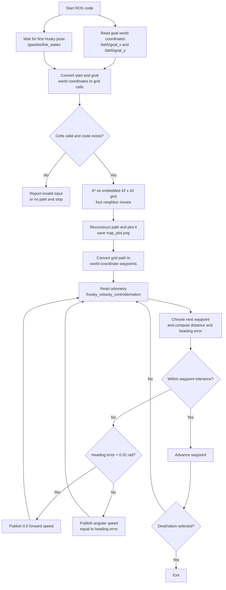

# Husky Path Planning and Gazebo Control

This ROS 1 catkin package contains a grid-based path planner and a Husky motion controller. The planner finds a route through a hard-coded occupancy grid with A*, displays and saves a map plot, and follows the route by publishing velocity commands based on odometry.

## Repository structure

```text
src/
├── CMakeLists.txt       # Catkin build configuration
├── package.xml          # ROS package metadata and dependencies
├── map.txt              # 42 × 42 occupancy-grid data
└── plan/
    └── planning.py     # A* planner, visualization, and Husky controller
```

The planner currently defines its own copy of the occupancy grid in `planning.py`; it does not load `map.txt` at runtime. In the grid, `1` marks an obstacle and `0` marks traversable space. A* searches the four neighboring cells, and helper functions convert between grid indices and world coordinates.

## Runtime behavior

The node:

1. Reads the goal coordinates from ROS parameters and obtains the robot's initial position from `/gazebo/link_states`.
2. Computes a path across the 42 × 42 grid.
3. Prints the grid and world-coordinate path, saves a visualization as `map_plot.png`, and opens it in an OpenCV window.
4. Tracks the route using `/husky_velocity_controller/odom` and publishes `geometry_msgs/Twist` commands to `/husky_velocity_controller/cmd_vel`.

There is no launch file in the repository, so Gazebo, the Husky model, the goal parameters, and any required ROS configuration must be started or supplied separately. The planner expects a Gazebo link named `husky::base_link` and a ROS environment that provides the topics and messages listed above.

## Implementation summary

The implementation has a planning stage followed by a waypoint-following stage:

1. **Get start and goal.** The node reads `/lab5/goal_x` and `/lab5/goal_y` as world coordinates. It waits for `/gazebo/link_states`, finds `husky::base_link`, and rounds its first reported x/y position to the nearest whole world unit for the start.
2. **Convert coordinates.** `world_to_grid` maps world coordinates onto the 42 × 42 array, and `is_safe` allows only in-bounds cells whose value is `0`. Values of `1` are obstacles.
3. **Plan with A*.** `a_star_func` searches the four cardinal neighbors. Each move costs one cell, and the priority is the accumulated cost plus Euclidean distance to the goal. Parent links are recorded so the route can be reconstructed. If no route is found, the node reports an error and stops.
4. **Visualize and convert the route.** The route is printed in grid and world coordinates, plotted over the occupancy grid, saved to `map_plot.png`, and displayed in an OpenCV window. Grid waypoints are converted back to world coordinates for motion control.
5. **Follow waypoints.** The node reads `/husky_velocity_controller/odom` and publishes `Twist` messages to `/husky_velocity_controller/cmd_vel`. It targets waypoints from the start end of the reconstructed route, advances when the robot is within 0.30 world units, and commands 0.5 forward speed when the heading error is under 0.02 radians. Otherwise it commands angular velocity equal to the heading error. It exits after selecting the destination waypoint.



The occupancy grid is currently duplicated in `planning.py`; `map.txt` is not loaded at runtime. The path cost and heuristic are defined in grid-cell units, while the waypoint-following tolerances and velocity commands operate in world coordinates and ROS units.

## Requirements

- ROS 1 with `rospy`, `geometry_msgs`, `nav_msgs`, `gazebo_msgs`, `sensor_msgs`, `visualization_msgs`, and `cv_bridge`.
- A running Gazebo Husky simulation publishing link states and Husky odometry.
- Python dependencies: NumPy, Matplotlib, and OpenCV (`cv2`), in addition to ROS Python packages and `tf`.
- A graphical display for the OpenCV window created by the planner.

The package metadata and CMake configuration are in `src/`. Build from a catkin workspace that contains this package directory:

```bash
cd ~/catkin_ws
catkin_make
source devel/setup.bash
```

The Python script is not currently registered as an installed catkin executable. Once the ROS master, simulator, and required goal parameters are available, it can be run from the repository root with:

```bash
python3 src/plan/planning.py
```

## Notes

The displayed/saved map comes from the grid embedded in the Python file, so editing `map.txt` alone does not change the route. The plotting code writes `map_plot.png` to the current working directory. The controller uses a simple waypoint-following loop; tune and validate it in simulation before using it with a physical robot.
